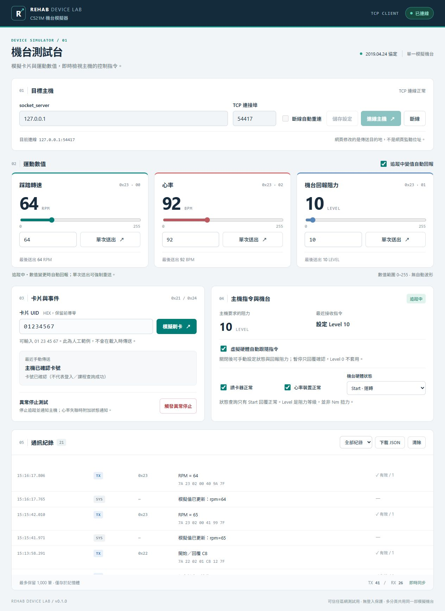
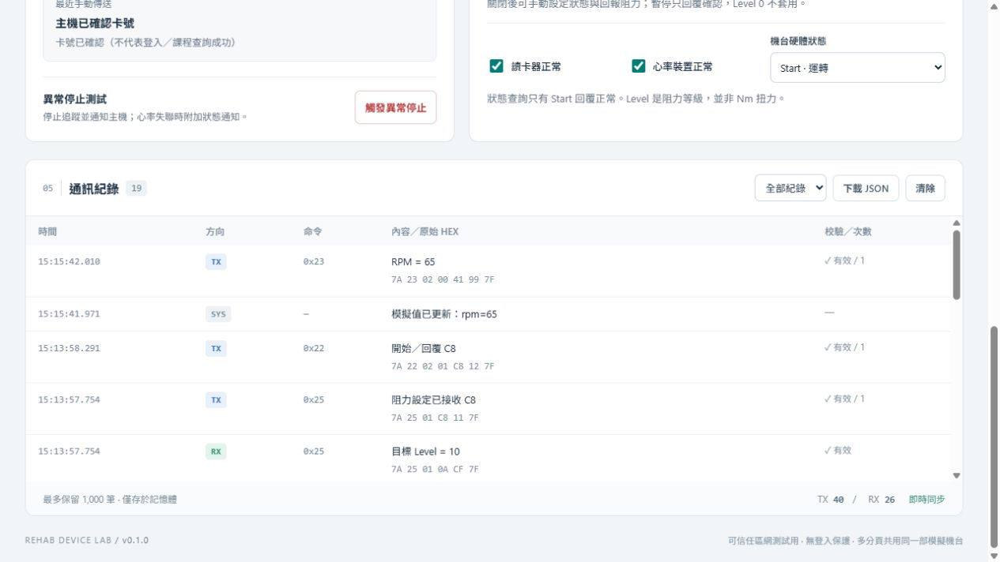

# 復健機 TCP 模擬儀表板

[](https://github.com/hplin50643/rehab_device_simulator/actions/workflows/tests.yml)

用瀏覽器模擬 C521M 樹莓派程式，向指定 TCP 主機傳送卡片 UID、轉速、心率與阻力等級，接收開始／停止／暫停、狀態查詢及阻力設定。不需要讀卡機、藍牙、GPIO 或實體復健機。

本工具是 **TCP client（機台端）**，不是接收機台連線的 TCP server，也不是 HTTP／Parse 課程後端。主要相容基準為 `20260701_C521M/pi/HeartBeatRate/multi_thread.py.20190424`。

## 畫面與功能



上圖由實際運行的網頁截取，UID 與數值皆為人工範例；`127.0.0.1` 及畫面埠號為僅供截圖的暫時測試對端，不是現場主機。

- **目標主機**：直接在網頁修改 `socket_server`、port 與自動重連，明確控制連線／斷線。
- **手動數值**：RPM、BPM、回報 Level 的滑桿／數字輸入，以及單次強制送出。
- **原版追蹤**：主機開始追蹤後，值改變才自動回報；沒有隨機數值或自動波形。
- **虛擬硬體**：自動跟隨主機啟停／Level，或改為手動狀態，測試讀卡器、心率裝置及機台四態。
- **完整紀錄**：TX／RX／系統事件、原始 HEX、校驗與重送次數，最多 1,000 筆，可篩選、清除及下載 JSON。
- **不假裝確認**：區分已排隊、已寫入 TCP、真正卡號 ACK、收到其他資料及逾時未確認。



## 執行需求與快速啟動

支援基準為 Python **3.12**，使用 Flask、Waitress、Jinja 與原生 JavaScript。無需 Docker、Node.js、資料庫或前端建置；套件安裝完成後，網頁不依賴 CDN、遠端字型或圖片。請先將本專案資料夾放到電腦，再進入該資料夾執行。

### Windows PowerShell

```powershell
py -3.12 -m venv .venv
.\.venv\Scripts\python.exe -m pip install -c constraints.txt -e .
.\.venv\Scripts\python.exe -m rehab_simulator
```

若沒有 `py`，請用已安裝的 Python 3.12 執行檔代替第一行。以上直接呼叫虛擬環境 Python，不需要調整 PowerShell 執行原則或啟用腳本。

### Ubuntu／Linux

先準備 Python 3.12 與其 `venv` 模組，再執行：

```bash
python3.12 -m venv .venv
.venv/bin/python -m pip install -c constraints.txt -e .
.venv/bin/python -m rehab_simulator
```

本機開啟 [http://127.0.0.1:5000](http://127.0.0.1:5000)。停止時在啟動程式的終端按 `Ctrl+C`。

預設網頁監聽 `0.0.0.0:5000`，區網其他裝置可開啟 `http://執行電腦的區網IP:5000`。`0.0.0.0` 是監聽位址，不是要填入瀏覽器的網址。防火牆開放與網路路由需由環境管理者決定，本工具不會自動更改系統設定。

> 此工具沒有登入或權限控管；所有能連到網頁的人，都能操作同一部模擬機台、修改目的地或查看卡號。只供可信任／隔離區網暫時測試，不要直接公開到網際網路。

可選啟動參數：

```bash
python -m rehab_simulator --web-host 127.0.0.1 --web-port 5001 --instance-dir ./instance
```

`--web-host`／`--web-port` 控制網頁服務，**不是** `socket_server`／TCP 9999。`REHAB_INSTANCE_DIR` 可設定資料目錄，明確傳入 `--instance-dir` 時優先使用參數。

## 第一次測試

1. 在實際平板／主機啟動對應的 TCP server，確認它在預期 IP 與 port 監聽。不要把此處填成 Parse 雲端 HTTP 位址。
2. 網頁輸入 `socket_server` 與 TCP port，按「儲存設定」，再按「連線主機」。預填的 `192.168.0.100:9999` 只來自原版設定，請依現場環境修改。程式開啟或重新啟動都不會自動連線。
3. 依測試情境設定讀卡器／心率裝置正常；若主機要求機台已運轉，將硬體狀態設成 `Start`。預設為原版冷啟動狀態：兩個裝置未就緒、機台 `End`、未追蹤。
4. 輸入人工 UID，例如 `01234567`，按「模擬刷卡」。前導零會保留，HEX 可含空白。
5. 等主機下達開始命令，調整 RPM／BPM／Level，查看 TX／RX。未開始追蹤時，可用「單次送出」測試指定數值。
6. 查看「主機要求的阻力」與「機台回報阻力」是否符合情境；需要測試不一致時關閉自動跟隨。
7. 切換目標主機前先斷線，等待取消完成，再儲存新目的地及連線。

多個分頁共享全部狀態。另一個分頁修改目標設定時，尚未儲存的表單不會被覆寫；版本衝突時按「還原目前設定」後重新編輯。

## 必須知道的相容限制

- `0x25` 是 **阻力等級 Level**，不是已校正的 Nm 扭力。真正 torque、Watt、距離與熱量沒有由此版 TCP 傳送。
- 開始／停止保留約 0.5／3.5 秒的非阻塞延遲；暫停只回覆成功，不停止追蹤。重疊啟停依順序排程。
- 收到 Level 0 會回覆並更新目標值，但不改模擬硬體阻力。大於 255 的設定可顯示；無法用合法單 byte 回報，因此顯示警告而不截斷。
- 非 `0x23` 主動通知最多送 3 次，每次等 0.5 秒。任何有效 RX 可結束 legacy 等待，但不一定是真正 ACK。部分對端本來就不回覆異常停止／狀態通知；逾時不代表確定未送達。
- 斷線會取消待送事件與未完成的控制，刷卡不跨連線重放。若仍保持追蹤，重連時以當前數值重新建立比較基準，避免取消／離線數值自動重放；請再次改值或用單次送出。畫面「最後送出」只記錄實際成功寫入 TCP 的值。
- 不同 APK 的完整互通仍需在實際環境驗收；NCKUHSport 的補充證據不等於已驗證 RunRunAnimals。

詳見 [協定說明](docs/PROTOCOL.md)。

## 開發與驗證

使用對應虛擬環境的 Python 執行：

```bash
python -m pip install -c constraints.txt -e ".[test]"
python -m pytest -q
python -m ruff check .
python -m ruff format --check .
python -m build
```

所有自動化 TCP 測試只連 loopback 臨時埠，不會連到設定的現場 IP。GitHub Actions 於 push／pull request 觸發 Windows／Ubuntu + Python 3.12 測試；執行結果見 [Actions](https://github.com/hplin50643/rehab_device_simulator/actions/workflows/tests.yml)。

## 文件與資料

- [架構與 API](docs/ARCHITECTURE.md)：資料流、模組責任、執行緒、API 與事件游標。
- [協定與證據](docs/PROTOCOL.md)：命令、固定封包、來源雜湊、相容行為與差異。
- [維護手冊](docs/MAINTENANCE.md)：設定備份、故障排除、更新、測試與截圖重現。
- [驗證紀錄](docs/VERIFICATION.md)：離線測試、瀏覽器操作及尚未完成的現場驗收界線。
- [開發協作](CONTRIBUTING.md) 與 [變更紀錄](CHANGELOG.md)。

只有連線設定持久化於 `instance/settings.json`。數值、連線、計數與通訊事件都在記憶體，重新啟動即清除；先下載 JSON 才能保留事件。

公開儲存庫：[hplin50643/rehab_device_simulator](https://github.com/hplin50643/rehab_device_simulator)。Repository 只包含本專案程式、文件與人工範例；不包含 APK、舊系統備份、真實卡號、現場設定、虛擬環境或執行期紀錄。目前未指定開源授權，公開儲存庫不代表已授予開源使用授權。
