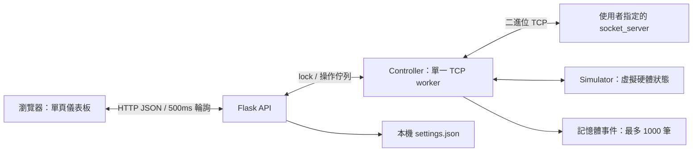

# 架構與 API

## 資料流

這是一部虛擬機台、一條對外 TCP 連線。網頁上的多個分頁、不同使用者都操作同一份狀態，不是每人一台。沒有 UART、BLE、GPIO 或 HTTP／Parse 後端，也沒有可操作的假主機產品。

## 模組責任

| 模組 | 責任 |
| --- | --- |
| `rehab_simulator/app.py` | Flask factory、JSON／HTTP 邊界、靜態資源與輸入錯誤 |
| `protocol.py` | 純 bytes 封包、UID、校驗、增量拆包；無網路依賴 |
| `simulator.py` | 純狀態機、啟停 FIFO 計時、Level 與狀態查詢、變值條件 |
| `transport.py` | Controller、連線世代、唯一收送者、佇列、legacy 等待與自動重連 |
| `storage.py` | 設定驗證／原子儲存、1000 筆事件環形緩衝 |
| `templates`／`static` | 繁中 Jinja、CSS、原生 JavaScript 與增量更新 |
| `__main__.py` | Waitress 單程序啟動與關閉 |

HTTP handler 不讀取 socket，也不等待主機 ACK。worker 唯一擁有 TCP 收送，RLock 保護共享狀態，實際 sendall 亦序列化；每次小封包發送有有限 timeout。程式匯入或建立 Flask app 不啟動連線，正式入口啟動 worker，但仍必須按網頁「連線」。

不能把此架構直接改成多個獨立 worker process，否則會有多條 TCP client 和不同狀態。不要啟用 Flask development reloader。

## 狀態與時序

- 裝置 readiness、硬體狀態 `Idle/Start/Pause/End`、tracking 互相獨立。預設自動跟隨啟停更新硬體狀態，但可關閉。
- START 0.5 秒、STOP 3.5 秒，以 monotonic 時間排入 FIFO；等待期間仍可查詢狀態或接收其他命令。PAUSE 立即 ACK，不更動 tracking。
- 接收目標 Level 與模擬回報 Level 分開。大於 255 不輸出非法遙測；手動輸入仍限制為 0–255。
- `auto_baseline` 是變值比較基準，`last_sent` 是確實寫入 TCP 的數值，初始為 null。不得混用，以免把未送值顯示為已送出。
- 非遙測通知只有一筆待確認；直接控制回覆有優先權且不再等待 ACK。等待任何有效 RX 後仍正常 dispatch 該命令。
- 連線 generation 使已取消的舊候選 socket 無法掛接；disconnect 冪等。取消期間設定仍鎖定，直到 worker 完成取消。
- 連線失敗預設每 1 秒重試；socket connect timeout 為 3 秒，但作業系統 DNS 解析可能較久。取消不會把舊候選連線當作成功。
- 斷線丟棄佇列、等待與控制計時；若 tracking 仍開啟，重連時 rebase 目前數值，不重播離線值。數值與實際最後送出值仍保留供檢查。

## HTTP API

以下全部為同源 JSON API，除明確下載外不允許任意 MIME。沒有登入機制，不應對不可信網路提供服務。

| 方法／路徑 | 輸入／結果 |
| --- | --- |
| `GET /api/state` | settings、settings_revision、connection、simulation、last_delivery、queue_length、instance_id、snapshot_sequence |
| `PUT /api/settings` | 完整 `socket_server`、`socket_port`、`auto_reconnect`、`revision`；需已斷線 |
| `PUT /api/simulation` | 部分更新 rpm／heart_rate／reported_level、reader_ready／hr_ready、machine_state、auto_follow／auto_report |
| `POST /api/connection` | `{"action":"connect"}` 或 `{"action":"disconnect"}`；202 表示操作已接受，不代表完成連線 |
| `POST /api/send` | `{"type":"rfid","uid":"01234567"}`、`{"type":"telemetry","field":"rpm","value":60}` 或 `{"type":"unexpected_stop"}` |
| `GET /api/events?after=0&epoch=0` | events、cursor、epoch、reset、instance_id |
| `DELETE /api/events` | 空物件 `{}`；清除所有分頁共用的記憶體事件 |
| `GET /api/events/export` | 下載目前最多 1000 筆 JSON，可能包含敏感卡號 |

成功操作回傳最新狀態；傳送 202 僅代表排隊，實際結果請看事件。常見錯誤：400 輸入／格式不合法、409 未連線／設定版本衝突／仍在取消、413 超過 16 KB、415 非 JSON、500 內部錯誤（詳情只寫終端）。

布林值不能當整數，小數不截斷，未知欄位不忽略；所有 patch 先完整驗證才更新。設定檔存檔失敗保留原檔。

## 多分頁與事件游標

- `instance_id` 區分程式重新啟動，`snapshot_sequence` 排除同一程序較舊的 HTTP 回覆。
- 設定透過 revision 防止過期表單覆蓋；儲存期間鎖住欄位，不覆蓋正在編輯的草稿。
- 模擬值 PUT 依序提交；編輯中與正在提交的欄位分開保護。
- 事件 ID 在程序內單調遞增；清除只增加 epoch，不把 ID 歸零。舊 epoch／舊 cursor 回覆會被網頁丟棄，超出環形緩衝時由 reset 通知重取。
- 瀏覽器以 textContent 顯示事件，不執行封包文字。API 不開放 CORS，使用 CSP 與基本內容型別保護；這些不等於登入授權。

支援 WebMCP 的瀏覽器另可發現 `read_simulator_state`（唯讀）及 `configure_simulation_values`（與畫面相同的數值操作，追蹤中可能送出 TCP）。不支援此可選介面的瀏覽器仍可完整操作。
